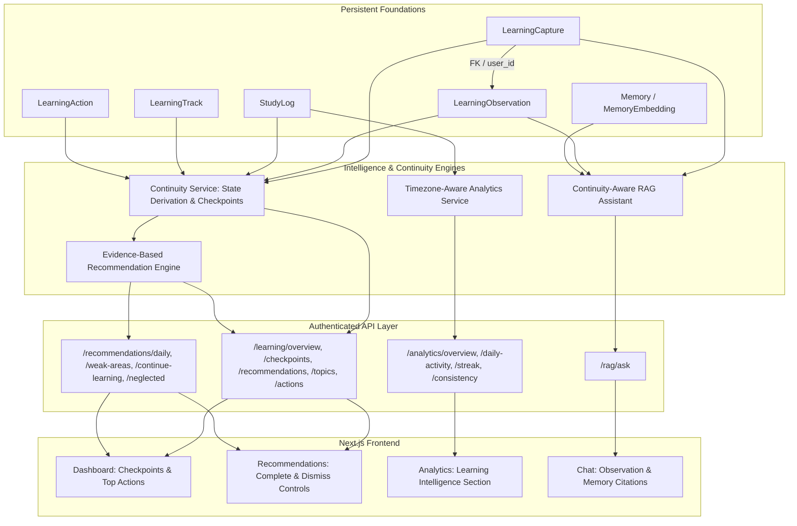

# Phase 3 Learning Intelligence, Continuity, Analytics, and Evidence-Based Recommendations Report

Date: 2026-10-22 (Asia/Calcutta)  
Starting Branch: `main`  
Starting Commit: `98e23f8c0339e67e5726fd353de2670b279e1dd5` (Phase 2 baseline)  
Working Tree Status: Clean working changes preserved; no reset, rebase, merge, commit, or push performed.

---

## Executive Summary

Phase 3 transforms confirmed unstructured learning captures into an actionable, evidence-based learning continuity system. Rather than creating generic study trackers or fabricating synthetic mastery percentages, the system answers the six core questions for returning learners:
1. **What have I been learning?** Reconstructed topic-level learning summaries derived strictly from confirmed `LearningCapture` and `LearningObservation` entities.
2. **Where did I leave off?** Resumable checkpoints pointing to the exact capture ID, observation ID, timestamps, and confirmed excerpts.
3. **What difficulties and questions have I recorded?** Specific, unresolved difficulties and open questions, with user-driven resolution controls.
4. **What should I study next?** Actionable recommendations ranked deterministically by user intent, unresolved difficulties, review eligibility, and continuity.
5. **Why are you recommending that?** Full provenance citations linking each recommendation to its exact source capture, observation, and quote.
6. **How has my study activity changed?** Timezone-aware streak, daily activity, and learning intelligence metrics separating logged study duration from captured learning facts.

Final test verification:
- **142 passed, 0 failed, 0 skipped** across the backend test suite, including 16 real PostgreSQL integration cases with pgvector HNSW index verification and 126 isolated unit/HTTP/service cases.
- **Frontend `npm run lint` and `npm run build`** passed with zero TypeScript and ESLint errors.

---

## 1. Architecture Changes

Phase 3 introduces a lightweight continuity and intelligence layer that operates non-destructively on top of Phase 1 and Phase 2 foundations:



Key architectural principles maintained:
- **Zero LLM ranking:** Recommendations are ranked by a deterministic, bounded multi-signal scoring algorithm.
- **Strict immutability:** Confirmed captures and observations are immutable historical records; follow-up action completions are recorded separately.
- **No invented metrics:** Study duration counts only real confirmed minutes; mastery percentages are strictly prohibited.
- **Backward compatibility:** Legacy endpoints (`/recommendations/daily`, `/rag/ask`, `/analytics/*`) continue to serve their contracts while delegating internally to the new evidence-based engine.

---

## 2. Existing Phase 2 Entities Reused

1. **`LearningCapture` (`backend/app/models/learning_capture.py`)**
   - Reused status (`confirmed` only), `confirmed_at`, `learning_track_id`, `study_log_id`, and `confirmed_interpretation`.
   - Captures with status `pending`, `failed`, or `discarded` are strictly excluded from confirmed continuity intelligence.
2. **`LearningObservation` (`backend/app/models/learning_capture.py`)**
   - Primary evidence unit with typed observations: `learned`, `understood_self_report`, `difficulty`, `open_question`, `intended_next_step`.
   - Observation IDs and excerpts are cited directly as recommendation and chat evidence.
3. **`StudyLog` (`backend/app/models/study_log.py`)**
   - Preserved as activity and study-duration context.
   - Captures without a linked `study_log_id` do not contribute fictitious minutes. Captures linked to a `study_log_id` do not double-count study minutes.
4. **`LearningTrack` (`backend/app/models/learning_track.py`)**
   - Provides user track grouping and identification of untouched tracks.
5. **`Memory` & `MemoryEmbedding` (`backend/app/models/memory.py`, `backend/app/models/memory_embedding.py`)**
   - Preserved for semantic memory search, while the continuity assistant operates seamlessly even when `create_memories=False`.

---

## 3. New Tables and Alembic Revisions

### Alembic Revision: `f30100000001`
- File: `backend/alembic/versions/f30100000001_learning_actions.py`
- Down revision: `f20200000002` (Phase 2 head).
- Forward-only, non-destructive migration. Downgrade raises `RuntimeError` to prevent accidental data loss.

### Model: `LearningAction` (`backend/app/models/learning_action.py`)
Persists user feedback, completion, and dismissal without mutating immutable confirmed observations:
- `id`: Integer, primary key.
- `user_id`: Integer, foreign key to `users.id` with `ON DELETE CASCADE`, indexed.
- `idempotency_key`: String(128), unique constraint per user (`uq_learning_action_user_idempotency`).
- `action_type`: String(64), check constraint `action_type IN ('next_step', 'difficulty', 'question', 'review', 'recommendation')`.
- `status`: String(32), check constraint `status IN ('completed', 'resolved', 'dismissed')`.
- `observation_id`: Integer, nullable foreign key to `learning_observations.id` (`ON DELETE SET NULL`), indexed.
- `capture_id`: Integer, nullable foreign key to `learning_captures.id` (`ON DELETE SET NULL`), indexed.
- `learning_track_id`: Integer, nullable foreign key to `learning_tracks.id` (`ON DELETE SET NULL`).
- `topic`: String(255), nullable, indexed.
- `recommendation_id`: String(255), nullable, indexed.
- `notes`: Text, nullable user follow-up note.
- `created_at` / `updated_at`: Timezone-aware datetimes with server defaults.

---

## 4. Learning State Derivation Rules

The system represents state honestly without claiming subject mastery:

| State | Derivation Criteria | Meaning |
|---|---|---|
| `needs_attention` | At least one confirmed observation of type `difficulty` or `open_question` has not been marked `resolved` or `dismissed` by the user. | Topic has outstanding blockers or questions. |
| `review_suggested` | Topic has confirmed observations, $\ge 3$ days have elapsed since last activity, and no review action was recorded within 3 days. | Eligible for review reminder based on interval policy. |
| `self_reported_understood` | User confirmed at least one `understood_self_report` observation for the topic, and no unresolved difficulties exist. | Self-reported understanding (explicitly distinguished from assessed mastery). |
| `exploring` | Active study within the last 7 days without reported difficulties or settled self-reports. | Active exploratory learning in progress. |
| `recorded` | Confirmed learning observations or legacy study logs exist, but activity is older than 7 days and no unresolved difficulties remain. | Historical baseline on record. |
| `insufficient_evidence` | No confirmed observations or study logs recorded for the user/topic. | Setup / start state. |

---

## 5. Continuity and Checkpoint Algorithm

Checkpoints are computed dynamically to ensure 100% truthfulness against actual database records:

1. **Owner-Scoped Retrieval:** Confirmed captures (`status = 'confirmed'`) and observations belonging to `current_user.id` are retrieved.
2. **Topic Grouping:** Grouped by `(learning_track_id, normalize_topic(topic))` where `normalize_topic(t) = " ".join(t.split()).casefold()`.
   - Topics with identical names in different tracks remain strictly isolated.
   - Topics without a track (`track_id = None`) are grouped together safely.
   - Original human-readable capitalization is preserved for UI presentation.
3. **Action Filtering:** All user actions (`resolved`, `completed`, `dismissed`) are mapped against observation IDs and recommendation IDs.
4. **Checkpoint Synthesis:** For each group, the checkpoint identifies:
   - Latest confirmed capture ID and timestamp.
   - Latest capture excerpt (up to 160 characters).
   - Latest observation ID and content.
   - Filtered lists of `understood_self_reports`, `unresolved_difficulties`, `unresolved_questions`, and `pending_next_steps`.
   - Review eligibility flag.
   - Days elapsed since latest confirmed study activity.

---

## 6. Recommendation Ranking Policy

Recommendations are deterministically ordered and deduplicated per topic per type:

### Priority and Ordering Hierarchy:
1. **Pending Intended Next Actions (`type: "intended_next_step"`):**
   - Observations of type `intended_next_step` not completed or dismissed.
   - Priority: `high` if $< 7$ days old; `medium` otherwise.
   - Action: `"Complete your intended next step: {content}"`.
   - Reason: `"Based on your confirmed plan from Capture #{capture_id}"`.
2. **Previously Reported Difficulties (`type: "unresolved_difficulty"`):**
   - Unresolved `difficulty` observations. Priority: `high`.
   - Action: `"Work through reported difficulty with {topic}: {content}"`.
   - Reason: `"You previously recorded this difficulty in Capture #{capture_id}"`.
3. **Open Questions (`type: "open_question"`):**
   - Unresolved `open_question` observations. Priority: `medium`.
   - Action: `"Resolve open question about {topic}: {content}"`.
   - Reason: `"You noted this open question in Capture #{capture_id}"`.
4. **Review Suggestions (`type: "review_suggestion"`):**
   - Topics eligible under review interval rules. Priority: `high` if difficulties exist or $\ge 7$ days; `medium` otherwise.
   - Action: `"Review {topic} (last studied {days} days ago)"`.
   - Reason: `"Scheduled review based on activity interval ({days} days elapsed)"`.
5. **Continue Active Topic (`type: "continue_learning"`):**
   - Most recently studied topic when no pending step or difficulty exists. Priority: `low`.
   - Action: `"Continue studying {topic}"`.
   - Reason: `"Most recently active learning topic ({days} days ago)"`.
6. **Start Untouched Track (`type: "start_track"`):**
   - User tracks with zero confirmed captures and zero study logs. Priority: `low`.
   - Action: `"Start studying your new track: {track.name}"`.
   - Reason: `"You created this learning track but have not recorded study activity yet"`.

### Deterministic Sort Key:
`(-priority_rank, category_rank, topic.casefold(), stable_id)`

---

## 7. Review Scheduling Assumptions

- **Policy:** Conservative baseline heuristic configured via `REVIEW_INITIAL_INTERVAL_DAYS` (default: 3 days).
- **Eligibility:** A topic is eligible for review if:
  1. It has confirmed learning observations.
  2. $\ge 3$ days have passed since the latest study activity.
  3. No completed review action has been recorded for that topic within the last 3 days.
- **Evidence Requirement:** Review recommendations always cite the actual last confirmed observation text or capture excerpt.
- **Scientific Claim Disclaimers:** The system explicitly does not claim to measure biological retention, forgetting curves, or spaced-repetition mastery. It acts solely as an activity-based study reminder.

---

## 8. User Feedback and Completion Semantics

- **Idempotency:** `POST /learning/actions` requires an `idempotency_key`. Retried requests return the existing record with identical attributes.
- **Non-Destructive:** Creating or resolving an action never mutates or deletes the underlying `LearningObservation` or `LearningCapture`.
- **Reversibility:** Actions can be transitioned between `completed`, `resolved`, and `dismissed` via `POST /learning/actions/{id}/update` or `PATCH /learning/actions/{id}`.
- **Distinction:** Self-reported completion of a recommended action is recorded as an action completion (`status: "completed"`), never interpreted as certified subject mastery.

---

## 9. Analytics Definitions

- **Logged Study Hours:** $\sum \text{StudyLog.duration\_minutes} / 60.0$. Captures without confirmed study duration add zero minutes. Captures linked to a `study_log_id` are counted exactly once.
- **Confirmed Captures:** Count of `LearningCapture` where `status = 'confirmed'`.
- **Distinct Topics:** Count of distinct normalized topic names across confirmed captures and study logs.
- **Observations Breakdown:** Exact counts of `learned`, `understood_self_report`, `difficulty`, and `open_question` observations.
- **Timezone-Aware Streak:**
  - Evaluated in the user's validated IANA timezone (default: UTC).
  - Timestamps are converted from UTC to user calendar dates before grouping.
  - Streak counts consecutive calendar days leading up to the user's `today` or `yesterday`.
  - Handles midnight crossovers and daylight saving time boundaries accurately.
- **Consistency Score:** $0.7 \times \text{Frequency} + 0.3 \times \min(\text{Streak}, 30)$, preserving the Phase 1 formula while using timezone-correct day counts.

---

## 10. New and Modified API Endpoints

### New Continuity Endpoints (`backend/app/routes/learning.py`)
- `GET /learning/overview?timezone=UTC`: Authenticated summary of user learning intelligence metrics.
- `GET /learning/checkpoints?track_id={id}&limit=20`: Resumable checkpoints for active topics.
- `GET /learning/recommendations?limit=10`: Prioritized, evidence-linked next actions.
- `GET /learning/topics?track_id={id}&limit=50`: Topic-level continuity summaries.
- `POST /learning/actions`: Idempotent endpoint to record user action feedback.
- `POST /learning/actions/{action_id}/update` / `PATCH /learning/actions/{action_id}`: Update action status and notes.

### Adapted Recommendation Endpoints (`backend/app/routes/recommendation.py`)
- `GET /recommendations/daily`: Returns enriched `RecommendationResponse` objects powered by `continuity_service`.
- `GET /recommendations/weak-areas`, `/continue-learning`, `/neglected`: Filtered views on the unified evidence-based recommendation engine.

### Enhanced Analytics Endpoints (`backend/app/routes/analytics.py`)
- `GET /analytics/overview`, `/daily-activity`, `/streak`, `/frequency`, `/consistency`, `/topic-recency`, `/neglected-topics`: Now accept an optional validated `timezone: str = "UTC"` parameter.

### Continuity-Aware Assistant (`backend/app/routes/rag.py`)
- `POST /rag/ask`: Fully backward-compatible. Answers direct continuity questions deterministically from confirmed records without LLM calls, and retrieves both memory embeddings and confirmed observations for general queries.

---

## 11. Source Citation and Provenance Design

Every recommended action and continuity answer cites its supporting records:
- **`source_capture_id`**: Direct reference to the user's confirmed `LearningCapture`.
- **`source_observation_id`**: Direct reference to the specific `LearningObservation`.
- **`evidence`**: The exact quote or text excerpt confirmed during Phase 2 ingestion.
- **Frontend Citations:** In the Chat interface, memory sources link to `/dashboard/memories/{id}`, while observation sources render as `[Observation {id}]` and link to `/dashboard/capture`.

---

## 12. Frontend Integration

1. **Dashboard (`frontend/app/dashboard/page.tsx`):**
   - Metric cards display real active recommendation count.
   - Replaced empty Memory Workspace placeholder with "Continue Where You Left Off".
   - Displays resumable checkpoint cards with state badges, last study date, blocker counts, and capture links.
   - Displays top 3 evidence-based next actions with direct resolution links.
2. **Recommendations (`frontend/app/dashboard/recommendations/page.tsx`):**
   - Displays real prioritized action cards with provenance badges and quotes.
   - Interactive "Complete" and "Dismiss" buttons record user actions via `POST /learning/actions` and refresh the feed.
   - Empty state cleanly communicates when no pending actions remain.
3. **Analytics (`frontend/app/dashboard/analytics/page.tsx`):**
   - Preserves all four existing Recharts data visualizations without breaking changes.
   - Adds a dedicated "Learning Intelligence & Continuity" section displaying Confirmed Captures, Distinct Topics, Understood Self-Reports, and Reported Difficulties.
   - Passes user browser timezone (`Intl.DateTimeFormat().resolvedOptions().timeZone`) for accurate daily metrics.
4. **Chat (`frontend/components/chat/chat-interface.tsx`):**
   - Supports both `[Memory X]` and `[Observation Y]` badges with corresponding navigation links.

---

## 13. Data Isolation Guarantees

- **User Ownership:** Every query on `LearningCapture`, `LearningObservation`, `StudyLog`, `LearningTrack`, and `LearningAction` strictly filters by `user_id == current_user.id`.
- **No Cross-User Matching:** Topic grouping and normalizations are partitioned per user. Identically named topics across different users never share state, checkpoints, or recommendations.
- **Foreign Key Constraints:** Composite constraints and cascading foreign keys prevent cross-tenant record linking.
- **No Data Leakage:** Attempting to record an action on another user's observation or capture returns a 404 error.

---

## 14. Regression Tests and Actual Results

### Test Results Breakdown:
- **Total Backend Tests:** 142
- **Passed:** 142
- **Failed:** 0
- **Skipped:** 0 (with disposable PostgreSQL running)

```
============================== test session starts ==============================
backend\tests\test_api.py ..........................                     [ 18%]
backend\tests\test_capture.py ....................................       [ 43%]
backend\tests\test_continuity.py .............                           [ 52%]
backend\tests\test_history.py .                                          [ 53%]
backend\tests\test_memory_transactions.py ...........                    [ 61%]
backend\tests\test_postgres.py ................                          [ 72%]
backend\tests\test_rag.py ..                                             [ 73%]
backend\tests\test_validation.py ...................................     [100%]
====================== 142 passed, 3 warnings in 12.13s =======================
```

### Coverage of Specific Phase 3 Requirements:
- `test_empty_history`: Clean 200 responses with zero counts for new users.
- `test_confirmed_vs_unconfirmed_filtering`: Pending, failed, and discarded captures are excluded from confirmed facts.
- `test_missing_duration_and_no_double_counted_time`: Captures without duration add 0 minutes; linked study logs are not double-counted.
- `test_legacy_study_log_only_history`: Legacy logs count toward history and study time without fabricating confirmed observations.
- `test_multi_topic_and_multi_track_isolation`: Multiple topics in one capture and identically named topics across different tracks remain isolated.
- `test_cross_user_isolation`: Users cannot see each other's data or mutate other users' observations.
- `test_action_completion_idempotency_and_difficulty_resolution`: Idempotent action writes, difficulty resolution, and action updates.
- `test_deterministic_recommendation_ranking_and_provenance`: Strict ranking order, provenance citations, and untouched track recommendations.
- `test_existing_recommendation_endpoints_compatibility`: Complete backward compatibility for `/recommendations/daily`, `/weak-areas`, etc.
- `test_review_scheduling_interval_and_recent_acknowledgment`: 3-day interval scheduling and suppression after recent review completion.
- `test_timezone_streak_dst_and_midnight_boundaries`: Timezone conversions across midnight and rejection of invalid IANA timezones.
- `test_learning_assistant_deterministic_continuity`: Direct answering of continuity questions without LLM calls.
- `test_learning_assistant_without_memory_embeddings`: RAG assistant operates correctly when `create_memories=False`.

---

## 15. PostgreSQL Migration Verification

The forward migration `f30100000001` was verified against a real disposable PostgreSQL instance:
1. **Fresh Database Bootstrap:** All tables, foreign keys, unique constraints, and check constraints created cleanly from revision 0 to head.
2. **Upgrade from Previous Heads:** Data preserved across upgrades from `3d0e118a4fdf`, `305e4c8b7844`, `903ce59b718d`, and Phase 2 head `f20200000002`.
3. **Database Constraints:** Verified that invalid `status`, invalid `action_type`, or duplicate `(user_id, idempotency_key)` violations fail with database integrity errors.
4. **Isolated Subprocess Bootstrap:** Verified Alembic upgrade head succeeds in an isolated subprocess without application settings.

---

## 16. Remaining Limitations

1. **Natural Language Feedback:** Feedback actions are currently structured (`completed`, `resolved`, `dismissed`). Freeform retrospective notes are stored, but not yet re-analyzed into new structured observations until captured via Phase 2.
2. **Spaced Repetition Complexity:** The review scheduler uses a conservative static interval heuristic (3 days) rather than an adaptive algorithm like FSRS or SuperMemo SM-2.
3. **Local Vector Search in Unit Tests:** Cosine vector search requires pgvector; unit tests running against in-memory SQLite gracefully bypass vector search and test through mocks and PostgreSQL integration suites.

---

## 17. Phase 4 UI/Release Handoff

- **Design System Readiness:** All Phase 3 data structures (`ResumableCheckpoint`, `EvidenceRecommendation`, `TopicContinuity`, `LearningOverview`) provide typed contracts for Phase 4 redesign.
- **Interaction Contracts:** Endpoints for action resolution (`POST /learning/actions`) and status updates are fully functional and ready for drag-and-drop or rich kanban interactions in Phase 4.
- **Visual Presentation:** The Phase 3 UI utilizes existing Tailwind components, maintaining styling consistency without premature redesign work.

---

## 18. Manual Test Walkthrough with Realistic Example Captures

### Walkthrough Scenario:

#### Step 1: Ingest Python Learning Capture (Phase 2 Capture Pipeline)
**User Input:**
> "Studied Python decorators and closures for 45 minutes today. I understand how @wraps preserves metadata, but nested scope and closure variables are confusing. Tomorrow I want to solve three decorator exercises."

**Confirmed Observations:**
- Observation #1 (type: `understood_self_report`, topic: `Decorators`, content: `@wraps preserves metadata`)
- Observation #2 (type: `difficulty`, topic: `Closures`, content: `Nested scope and closure variables are confusing`)
- Observation #3 (type: `intended_next_step`, topic: `Decorators`, content: `Solve three decorator exercises tomorrow`)
- StudyLog created: 45 minutes on `Decorators`.

#### Step 2: Leave Application and Return Later
The learner logs in after two days.

#### Step 3: Inspect Dashboard Checkpoints
- Checkpoint #1: **Closures**
  - State: `needs_attention` (Red badge)
  - Blocker: 1 difficulty recorded: *"Nested scope and closure variables are confusing"*
  - Excerpt: *"Studied Python decorators and closures for 45 minutes today..."*
  - Action link: Source Capture.
- Checkpoint #2: **Decorators**
  - State: `self_reported_understood`
  - Self-report: *"@wraps preserves metadata"*
  - Pending action: 1 intended next step pending: *"Solve three decorator exercises tomorrow"*

#### Step 4: Inspect Recommendations Feed
- **Recommendation #1 (Priority: HIGH):**
  - Action: *"Complete your intended next step: Solve three decorator exercises tomorrow"*
  - Reason: *"Based on your confirmed plan from Capture #1"*
  - Provenance: Observation #3, Capture #1.
- **Recommendation #2 (Priority: HIGH):**
  - Action: *"Work through reported difficulty with Closures: Nested scope and closure variables are confusing"*
  - Reason: *"You previously recorded this difficulty in Capture #1"*
  - Provenance: Observation #2, Capture #1.

#### Step 5: Mark Action as Resolved
- Learner solves exercises and clicks **Complete** on Recommendation #1.
- `POST /learning/actions` records completion idempotently.
- Checkpoint #2 updates: pending next steps count drops to 0.

#### Step 6: Query Continuity Assistant
- **User Question:** *"What was I struggling with last time?"*
- **Assistant Response:**
  > "You previously reported the following difficulties:
  > - Closures: \"Nested scope and closure variables are confusing\" (Capture #1)"
  - Sources badge: `[Observation 2] Closures`.
- Grounded 100% in database records without LLM hallucination or external provider latency.
